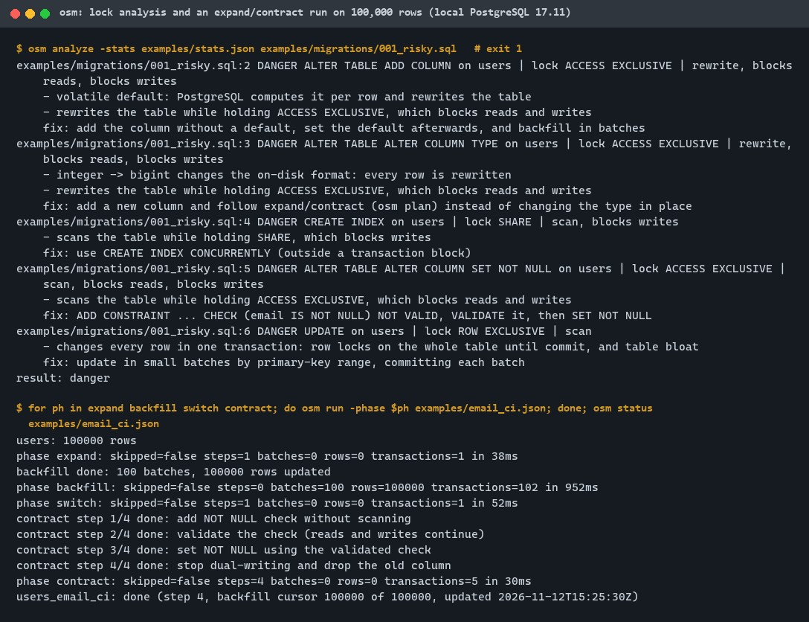
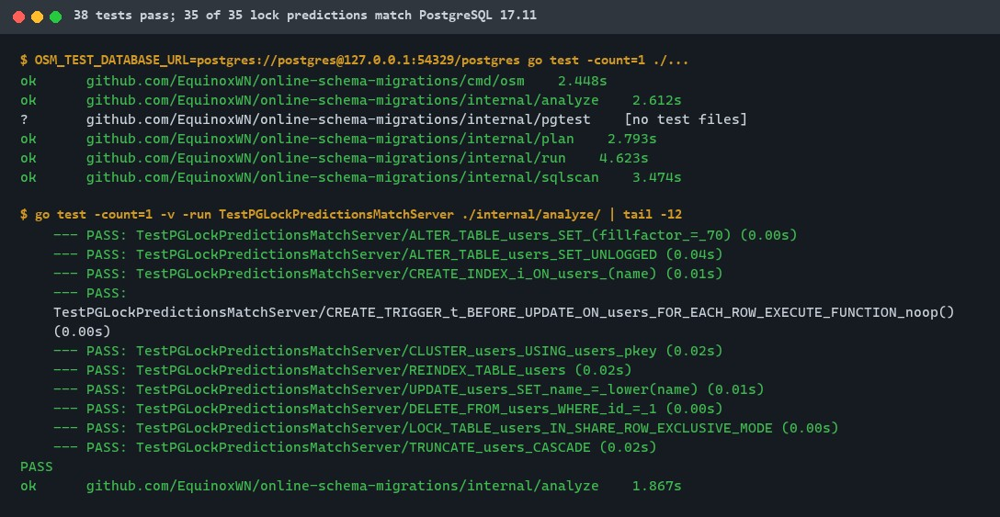
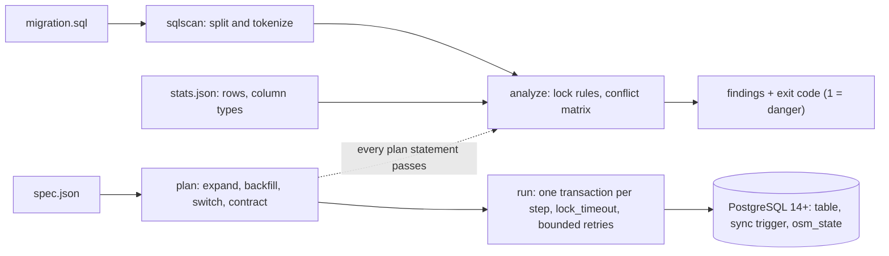
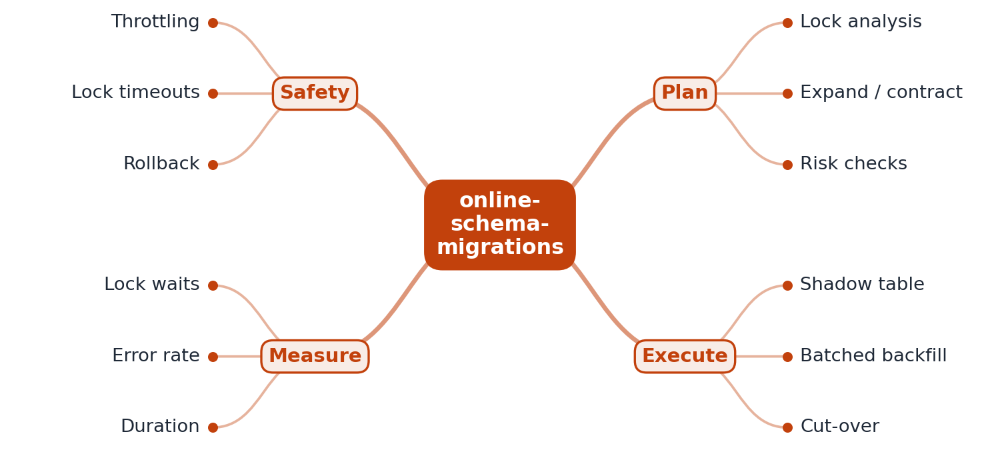

# online-schema-migrations

[](https://github.com/EquinoxWN/online-schema-migrations/actions/workflows/ci.yml)


> Adding a column to a 500-million-row table shouldn't take the site down: schema changes without long locks, with safe rollback.

Part of my **DevOps and Cloud** list · Go · core project

## Proof it works

`osm analyze` flags all five statements of a risky migration and names the safer form of each.
Then, on a local PostgreSQL 17.11 with a 100,000-row `users` table, `osm run` takes `email` to a
lower-cased, NOT NULL `email_ci` in four phases (backfill: 100 batches in 952 ms):



38 tests pass against that server, including 35 of 35 lock predictions checked against what
PostgreSQL actually holds in `pg_locks`:



## Architecture

**What M1 runs today:**



**Full roadmap (M1 to M3):**



## How it works

_Steps 1 and 2 are built and tested (M1); the rest is on the [roadmap](#roadmap)._

1. Each migration is analysed for the locks it would take; risky ones (rewriting a big table) are flagged before running.
2. Changes follow expand/contract: add the new column, dual-write, backfill, switch reads, then remove the old one.
3. For table rewrites, a shadow table is built and kept in sync while rows are copied in small batches.
4. Backfill throttles itself when replication lag or database load rises.
5. Cut-over takes a brief lock with a strict timeout and retries, instead of queuing behind long queries.
6. k6 runs load throughout, measuring lock waits and errors compared with a plain ALTER TABLE.

In M1, step 1 is `osm analyze`: for every statement (each `ALTER TABLE` action separately) it
reports the lock mode, whether the table is rewritten or scanned, and whether reads or writes are
blocked. A statement is `danger` when it rewrites or scans a table of at least `-max-rows` rows
(default 100,000) under a lock that blocks reads or writes, adds a NOT NULL column without a
default to a non-empty table, updates or deletes every row in one transaction, or runs
`CONCURRENTLY` inside a transaction block; it is `warn` when it waits for a blocking lock without
`lock_timeout`, removes data or a name, or is not recognised. Step 2 is `osm plan` and `osm run`:
a trigger keeps the old and new column in sync in both directions, the backfill runs in
committed, resumable key-range batches, switch refuses to continue while any row is out of sync,
and contract adds NOT NULL through a validated check before dropping the old column.

## Who it helps

- **Who:** Developers who write PostgreSQL migrations, and reviewers and on-call engineers who
  approve them, for tables that cannot go offline.
- **The problem:** It is hard to tell from the SQL which statement rewrites a table or waits for
  an `ACCESS EXCLUSIVE` lock, and renaming or retyping a column in one step breaks code that is
  still running.
- **How to use it:** Run `osm analyze` on the migration directory in CI (exit code 1 blocks the
  merge); for a column rename or type change, write a small spec, review `osm plan`, and run the
  four phases with `osm run`, deploying the new code between switch and contract.

## Tech stack

| Area | In M1 | Planned |
|---|---|---|
| Core | Go, PostgreSQL 14+ (checked on 17.11), pgx v5 driver | MySQL analyser |
| Analysis | Hand-written SQL scanner, lock rules, conflict matrix, stats file (ADR 0003) | Read row counts from the live catalog |
| Online DDL | Expand/contract with a sync trigger (ADR 0002), resumable batched backfill, advisory lock | Shadow tables, throttling on replication lag (M2), cut-over retries (M3) |
| Test | Go tests and fuzzing; real PostgreSQL locally (embedded binaries, no Docker) and in CI | k6 load during migrations (M3) |

| Path | What it is |
|---|---|
| `internal/sqlscan` | Statement splitter and tokenizer (quotes, dollar quotes, nested comments) |
| `internal/analyze` | Lock modes and conflict matrix, per-statement rules, risk verdicts |
| `internal/plan` | Spec validation and the four phases of SQL with rollbacks |
| `internal/run` | Runs phases against PostgreSQL; progress in `osm_state` |
| `internal/pgtest` | Isolated schema per integration test |
| `cmd/osm` | The `osm` command |
| `scripts/local-postgres.sh` | Local PostgreSQL 17.11 from embedded binaries in `.tmp/` |
| `examples/` | Risky and safe migrations, a stats file, two specs |

## Run it

Needs Go 1.25+ (CI: 1.26.11). For the commands that touch a database: PostgreSQL 14 or newer.

```bash
make setup
go run ./cmd/osm analyze -stats examples/stats.json examples/migrations/001_risky.sql   # exit 1
go run ./cmd/osm analyze -stats examples/stats.json examples/migrations/002_safe.sql     # exit 0
go run ./cmd/osm plan examples/email_ci.json      # SQL of every phase, with its rollback
```

The stats file gives row counts and current column types (without it every table counts as
large and every type change as a rewrite). Fill it from the database:
`SELECT relname, reltuples::bigint FROM pg_class WHERE relkind = 'r'` and
`SELECT column_name, data_type FROM information_schema.columns WHERE table_name = '...'`.

Run a change (one phase per call; repeating a finished phase does nothing):

```bash
export OSM_DATABASE_URL='postgres://app@db.example:5432/app'   # password from ~/.pgpass or PGPASSWORD
osm run -phase expand   examples/email_ci.json
osm run -phase backfill examples/email_ci.json   # resumable; -max-batches N to stop early
osm run -phase switch   examples/email_ci.json   # then deploy code that reads email_ci
osm run -phase contract examples/email_ci.json   # after no code uses email any more
osm status examples/email_ci.json
osm run -phase rollback examples/email_ci.json   # any time before contract
```

Flags for `run`: `-retries` (lock-timeout retries, default 5), `-statement-timeout` (default 5m),
`-max-batches`. Spec fields: `id`, `table`, `key` (integer column), `kind` (`rename_column` or
`change_type`), `from`, `to`, `type`, `up`/`down` (SQL expressions, `change_type` only),
`not_null`, `batch_size` (default 1000), `lock_timeout` (default 2s).

| Environment variable | Used by | Meaning |
|---|---|---|
| `OSM_DATABASE_URL` | `osm run`, `osm status` | PostgreSQL connection string |
| `OSM_TEST_DATABASE_URL` | tests | Server for the integration tests; they skip when it is unset |
| `OSM_PG_PORT` | `scripts/local-postgres.sh` | Port of the local server (default 54329) |

## Tests and results

Latest local run (full detail in [docs/results/m1.md](docs/results/m1.md)):

| Test file | Tests | What it proves |
|---|---|---|
| `internal/sqlscan/sqlscan_test.go` | 6 | Splitting keeps quoted, dollar-quoted and commented semicolons; line numbers; unterminated and oversized input refused; fuzzing never panics |
| `internal/analyze/analyze_test.go` | 11 | 58 statement forms (lock, rewrite, scan, risk); per-action findings; same-file tables exempt; validated NOT NULL check; `-max-rows` boundary; 16 type-change pairs; conflict matrix; stats validation |
| `internal/analyze/pg_test.go` | 2 | 35 of 35 lock and rewrite predictions match PostgreSQL 17.11 (`pg_locks`, `relfilenode`); NOT NULL without default fails as predicted |
| `internal/plan/plan_test.go` | 5 | 20 kinds of bad spec refused; phase order and rollbacks; every plan statement is free of danger on a 500-million-row table |
| `internal/run/run_pg_test.go` | 7 | Full expand/contract while old code writes; resume after a stop; backfill never touches old values; switch gate; bounded lock-timeout retries; rollback; two concurrent runners; empty table; text key refused |
| `cmd/osm/main_test.go` | 7 | Exit codes, JSON, bad input, `plan`, and all phases through the CLI on a real server |

| Check | Result |
|---|---|
| Tests (local PostgreSQL 17.11) | 38 passed, 0 failed, 0 skipped (137 with subtests) |
| Lock predictions checked on the server | 35 of 35 match |
| Expand/contract with concurrent old-code writes | 3,000 rows, 0 out of sync, 0 old values changed |
| Demo, 100,000 rows | expand 38 ms, backfill 952 ms (100 batches), switch 52 ms, contract 30 ms |
| Mutation check | 13 of 13 hand mutations killed |
| govulncheck v1.8.0 (Go 1.26.11) | No vulnerabilities found |

Without a server, the 10 PostgreSQL tests skip with a message; `make test-pg` and CI fail on any
skip. The race detector runs in CI only (no cgo on the development machine), and the CI jobs have
not run yet. The 10 quality rules and the mutation table are in
[docs/quality/2026-11-01.md](docs/quality/2026-11-01.md).

Local server without Docker:

```bash
make pg-start    # or: bash scripts/local-postgres.sh start  (PostgreSQL 17.11 binaries into .tmp/, SHA-256 checked)
export OSM_TEST_DATABASE_URL='postgres://postgres@127.0.0.1:54329/postgres?sslmode=disable'
make test-pg
make pg-stop
```

## Roadmap

**M1** (≈15 h)
- [x] Write `docs/rfc/0001-design.md`: problem, goals, non-goals, chosen design
- [x] Each migration is analysed for the locks it would take; risky ones (rewriting a big table) are flagged before running.
- [x] Changes follow expand/contract: add the new column, dual-write, backfill, switch reads, then remove the old one.

**M2** (≈20 h)
- [ ] For table rewrites, a shadow table is built and kept in sync while rows are copied in small batches.
- [ ] Backfill throttles itself when replication lag or database load rises.

**M3** (≈25 h)
- [ ] Cut-over takes a brief lock with a strict timeout and retries, instead of queuing behind long queries.
- [ ] k6 runs load throughout, measuring lock waits and errors compared with a plain ALTER TABLE.
- [ ] Publish the proof below with real numbers

## Proof

What this repo must show before it counts as done:

- Lock waits and error rate under load: plain ALTER TABLE vs the online method.

| Result | Value |
|---|---|
| M3 proof above | Not measured yet (M3). Current M1 numbers: see [Tests and results](#tests-and-results). |

## Why it matters

- **Interview angle:** 'Change the schema of a huge production table' and zero-downtime deployment questions.
- **Upstream I'd like to contribute to:** gh-ost (GitHub) or pgroll (Xata): docs or tests.

## Design docs

- [RFC 0001: design](docs/rfc/0001-design.md)
- [ADR 0001: record architecture decisions](docs/adr/0001-record-architecture-decisions.md)
- [ADR 0002: dual-write with a trigger and a new column name](docs/adr/0002-trigger-dual-write.md)
- [ADR 0003: hand-written SQL scanner, checked against a real server](docs/adr/0003-hand-written-scanner-checked-by-server.md)
- [M1 results](docs/results/m1.md)

## Scope

This is a learning and portfolio system, not a hosted production service. Known limits of M1:
PostgreSQL only; lock rules target PostgreSQL 14 to 17 and are checked against 17.11 only; the
`CONCURRENTLY` forms and `VACUUM FULL` cannot run in a transaction, so their rules are not
server-checked; row counts come from a stats file, not the live catalog; the trigger's cost per
write is not measured yet.

## Security and contributing

- Spec names are restricted to lower-case identifiers and always quoted; expressions may not
  contain `;`. The `up`/`down` expressions are SQL and are trusted like any migration file.
- The connection string is read from `OSM_DATABASE_URL`, never from a command-line argument.
- Every GitHub Action is pinned to a commit SHA and the PostgreSQL image to a digest; workflows run read-only, without persisted credentials.
- Dependabot update pull requests are paused (`open-pull-requests-limit: 0`) so the repository keeps a single `main` branch; dependencies are updated by hand and checked by the CI audit.
- Report vulnerabilities privately: see [SECURITY.md](SECURITY.md). To contribute, see [CONTRIBUTING.md](CONTRIBUTING.md).

## License

MIT, see [LICENSE](LICENSE).
